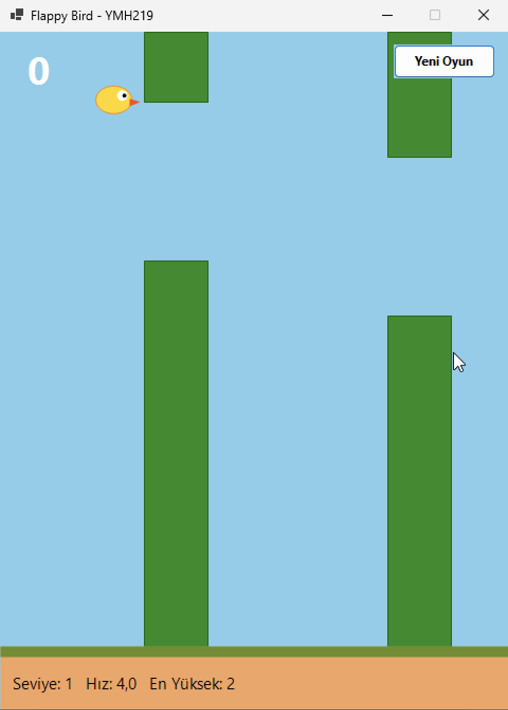
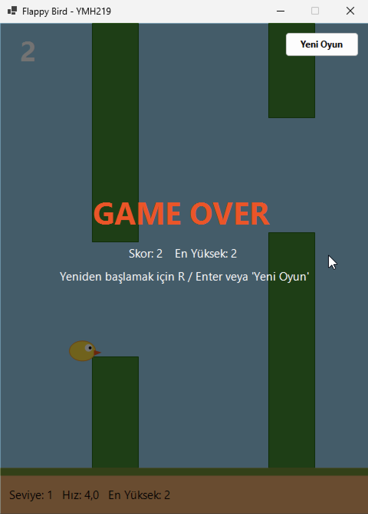

# YMH219 - Flappy Bird

Nesne Tabanlı Programlama (YMH 219) dersi ek uygulama ödevi kapsamında C# Windows Forms ile geliştirdiğim Flappy Bird benzeri basit bir masaüstü oyunu. Kuş, Space tuşuyla zıplıyor; yer çekimi onu aşağı çekiyor. Amaç borulara ve zemine çarpmadan olabildiğince çok engel geçmek.

**Öğrenci:** Miraç Özcan AĞCABAY - Öğrenci No: 250541002

## Kullanılan Teknolojiler

- C# / .NET 8 (net8.0-windows)
- Windows Forms
- `System.Windows.Forms.Timer` (oyun döngüsü)
- GDI+ (`Graphics`) ile çizim
- Harici NuGet paketi yok

## Proje Yapısı

| Dosya | Açıklama |
|---|---|
| `Kus.cs` | Kuşun konumu, dikey hızı, yer çekimi ve zıplama işlemi |
| `Engel.cs` | Üst ve alt borudan oluşan engel çifti, hareket ve çarpışma kontrolü |
| `OyunYoneticisi.cs` | Skor, seviye, hız, oyun durumu; engelleri yeniden konumlandırma; en yüksek skoru dosyaya kaydetme |
| `Form1.cs` | Timer, klavye olayları (KeyDown) ve ekrana çizim (Paint) |

## Kurulum ve Çalıştırma

1. Depoyu klonlayın:
   ```bash
   git clone https://github.com/magcabay/YMH219-FlappyBird.git
   ```
2. `FlappyBird.sln` dosyasını Visual Studio 2022 ile açın.
3. `F5` ile çalıştırın.

Komut satırından çalıştırmak için (Windows):
```bash
dotnet run --project FlappyBird
```

## Kontroller

| Tuş | İşlev |
|---|---|
| `Space` / `Yukarı Ok` | Zıpla (ilk basışta oyun başlar) |
| `R` / `Enter` | Oyun bittiyse yeniden başlat |
| **Yeni Oyun** butonu | Oyunu sıfırdan başlatır |

## Özellikler

- Kuş klavye ile yukarı zıplıyor, yer çekimiyle aşağı düşüyor
- Ekranda 3 engel sağdan sola hareket ediyor; ekrandan çıkan engel rastgele boşlukla sağa geri alınıyor
- Boruya veya zemine çarpınca oyun duruyor ve **GAME OVER** ekranı çıkıyor
- Geçilen her engel için skor +1
- Her 5 puanda seviye artıyor ve oyun hızlanıyor
- En yüksek skor `enyuksekskor.txt` dosyasında saklanıyor
- Skor, seviye, hız gibi bilgiler `OyunYoneticisi` sınıfının özelliklerinde tutuluyor

## Ekran Görüntüleri





## Bilinen Sınırlamalar / Geliştirme Notları

- Grafikler resim yerine basit şekillerle (elips, dikdörtgen) çiziliyor.
- Ses efekti yok.
- Pencere boyutu sabit (480x640), yeniden boyutlandırılamıyor.
- İleride farklı zorluk seviyeleri ve ses efektleri eklenebilir.
